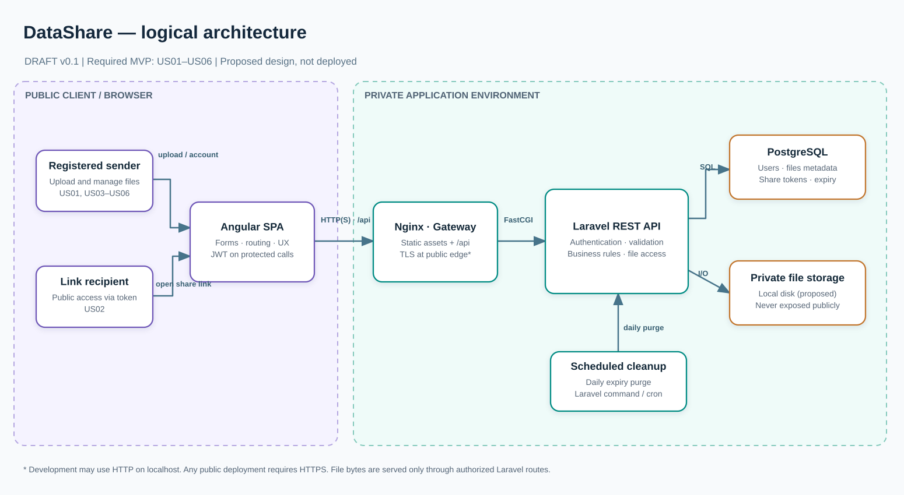

# DataShare — Architecture de l'application

**État :** conception validée dans DESIGN-01 et architecture du MVP implémentée en local. Le schéma initial reste un livrable conceptuel, pas un plan de déploiement de production.

**Source :** mission OpenClassrooms, étape 1 (*Concevez l'architecture technique*), et *DataShare — Spécifications fonctionnelles*, MVP **US01 à US06**.

- [English](architecture.md)
- [Diagramme draw.io modifiable](diagrams/architecture.drawio)
- [Diagramme vectoriel (SVG)](diagrams/architecture.svg)

## Architecture logique

Le schéma sépare la **zone publique du navigateur** de l'**environnement applicatif privé**. Les composants d'infrastructure inutiles à la compréhension du MVP sont volontairement exclus.

## Composants et responsabilités

| Composant | Responsabilité | Décision d'architecture |
| --- | --- | --- |
| Navigateur + application Angular | Interface, navigation, formulaires, retours utilisateur et appels API protégés | Frontend **retenu**, exécuté dans le navigateur |
| Nginx (passerelle HTTP) | Relayer le serveur Angular de développement et transmettre les requêtes `/api` à Laravel/PHP-FPM | Point d'entrée **retenu**, non imposé par OC |
| API REST Laravel | Authentification JWT, autorisations, validations serveur, règles métier, tokens de partage et streaming des fichiers | Backend **retenu** |
| PostgreSQL | Persister les comptes, métadonnées, tokens et dates d'expiration | Base de données **retenue** |
| Stockage privé des fichiers | Conserver les octets hors de la racine publique, uniquement accessibles depuis Laravel | **Retenu :** système de fichiers local, autorisé par le sujet ; alternative : AWS S3 |
| Purge planifiée | Supprimer les fichiers expirés et les métadonnées associées | Comportement **déjà requis par US01** ; commande Laravel et scheduler actifs |

Angular, Laravel, PostgreSQL et le stockage sont au cœur du design. Docker Compose est l'environnement de développement retenu, pas une brique métier ni une obligation de déploiement.

## Principaux flux

1. **Inscription et connexion (US03, US04).** L'utilisateur saisit ses identifiants dans Angular. L'API valide la demande et émet un JWT après une connexion réussie. Angular joint ensuite ce jeton aux requêtes protégées.
2. **Téléversement authentifié (US01).** Angular transmet le fichier et la durée choisie dans une requête REST protégée. Laravel contrôle l'authentification, la taille (**1 Go maximum**), les types autorisés et la durée (sept jours au maximum) ; il stocke les octets en privé et les métadonnées dans PostgreSQL, puis retourne un token/lien non prédictible.
3. **Téléchargement public (US02).** Le destinataire ouvre le lien sans compte. Laravel vérifie le token et l'expiration, présente les métadonnées exigées (nom, type, taille, expiration) puis transmet le fichier via l'API. Le stockage n'est jamais exposé directement.
4. **Historique et suppression (US05, US06).** Les requêtes protégées présentent uniquement les fichiers du propriétaire. Une suppression nécessite une confirmation côté frontend et un contrôle de propriété côté API ; les octets et métadonnées sont supprimés.
5. **Purge à expiration (US01).** Par défaut, la durée est de **sept jours**, selon les limites de l'énoncé. Une tâche planifiée retire les fichiers et leurs métadonnées. Les liens expirés ne doivent plus permettre le téléchargement, même avant la prochaine purge.

Les routes, structures de réponse et statuts HTTP relèvent de **DESIGN-03**. Les entités, attributs et cardinalités relèvent de **DESIGN-02**.

## Frontières de confiance et principes de sécurité

- Le **client n'est pas fiable** : les validations Angular améliorent l'ergonomie ; Laravel refait toutes les vérifications sensibles.
- Le JWT authentifie les opérations privées ; le token de partage ne permet qu'un téléchargement public limité dans le temps.
- Les fichiers restent dans un **stockage privé**, sans URL d'accès direct aux octets.
- Seul le propriétaire peut consulter son historique et supprimer ses fichiers.
- La politique des formats acceptés est documentée dans [SECURITY](https://github.com/jlbokass/datashare/blob/develop/SECURITY.fr.md).
- HTTPS est requis pour toute exposition publique ; HTTP peut être utilisé en local sur `localhost`.
- Les secrets et identifiants sont configurés hors du code source.

## Périmètre

**MVP obligatoire :** US01, US02, US03, US04, US05 et US06.

**Backlog avancé, non supposé développé :** US07 upload anonyme, US08 tags, US09 protection par mot de passe, US10 gestion avancée de l'expiration. Attention : la suppression automatique à expiration figure **déjà dans US01** et fait partie du MVP.

Le schéma doit rester cohérent avec le MCD et le contrat OpenAPI produits dans DESIGN-02 et DESIGN-03.

## Cohérence du stockage et de la base

Les suppressions manuelles et la purge utilisent `TransferDeletion` : une transaction PostgreSQL verrouille le transfert parent (`FOR UPDATE`), puis relit ses fichiers et, pour la purge, son expiration. Les opérations sur le même transfert sont ainsi sérialisées. La suppression du dernier fichier révoque le lien ; un téléchargement ayant déjà ouvert le fichier peut se terminer.

Le stockage et la BDD ne forment pas une transaction atomique. Les octets déjà absents permettent une suppression des métadonnées ; si le stockage échoue, les métadonnées sont conservées pour une nouvelle tentative. Si la BDD échoue après suppression des octets, ceux-ci ne sont pas restaurés. Un échec partiel de purge conserve les métadonnées pour reprise. La purge continue pour les autres transferts et signale l'échec par un code non nul. Les tests SQLite ne prouvent pas la concurrence réelle PostgreSQL.

Voir [maintenance](https://github.com/jlbokass/datashare/blob/develop/MAINTENANCE.fr.md) et [HIST-01 #57](https://github.com/jlbokass/datashare/issues/57) : purge actuelle conservée sans modification de code. Aucun déploiement de production n'est revendiqué.
