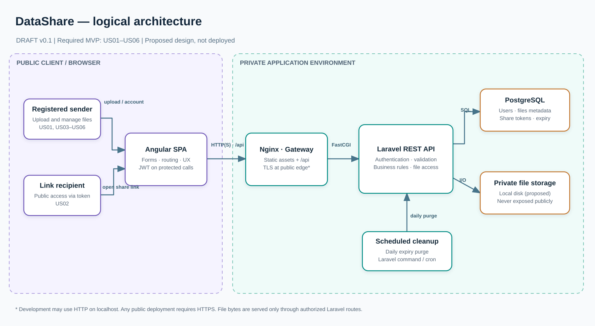

# DataShare — Application architecture

**Status:** design reviewed in DESIGN-01 and MVP architecture implemented locally. The initial diagram remains a conceptual deliverable, not a production deployment plan.

**Source:** OpenClassrooms mission, step 1 (*Concevez l'architecture technique*), and *DataShare — Spécifications fonctionnelles*, MVP **US01–US06**.

- [Français](architecture.fr.md)
- [Editable draw.io diagram](diagrams/architecture.drawio)
- [Vector diagram (SVG)](diagrams/architecture.svg)

## Logical architecture

The diagram separates a **public client/browser area** from the **private application environment**. It deliberately omits infrastructure that is not needed to explain the MVP.

## Components and responsibilities

| Component | Responsibility | Architecture decision |
| --- | --- | --- |
| Browser + Angular SPA | User interface, routing, forms, client feedback and protected API calls | **Selected** frontend; runs in the browser |
| Nginx gateway | Proxy the Angular development server and route `/api` requests to Laravel/PHP-FPM | **Selected** HTTP entry point; not an OC-mandated technology |
| Laravel REST API | JWT authentication, authorization, server-side input validation, business rules, share tokens and file streaming | **Selected** backend |
| PostgreSQL | Persist registered users, file metadata, share tokens and expiry timestamps | **Selected** database |
| Private file storage | Persist file contents outside the public web root; accessed only through Laravel | **Selected:** local filesystem, allowed by the specification; alternative: AWS S3 |
| Scheduled cleanup | Remove expired file contents and corresponding metadata | **Required behaviour in US01**; Laravel command and scheduler in use |

Only Angular, Laravel, PostgreSQL and a storage choice are needed at the core of this design. Docker Compose is the chosen development runtime, **not a separate business component or a required production platform**.

## Key flows

1. **Registration and authentication (US03, US04).** The user enters credentials in Angular. The API validates registration or login and issues a JWT on successful login. Angular sends the JWT on later protected API requests.
2. **Authenticated upload (US01).** Angular uploads file bytes and selected expiration via a protected REST request. Laravel validates authentication, the allowed size (maximum **1 GB**), permitted file types and expiry (no more than seven days); it stores bytes privately and metadata in PostgreSQL, then returns an unpredictable share token/link.
3. **Public download (US02).** The recipient opens the shared link without an account. Laravel validates its token and expiry, returns the required metadata (name, type, size, expiration), and streams the file through an API endpoint. Public clients never access the private storage directly.
4. **Personal history and deletion (US05, US06).** Protected API calls list only the owner's files. Deleting a file requires frontend confirmation and an ownership check on the API; the stored bytes and metadata are removed.
5. **Expiry cleanup (US01).** The sender's expiration choice defaults to **seven days**, is bounded by the specification, and a scheduled process removes expired bytes and metadata. Expired links must not serve files even before the next cleanup run.

Routes, response structures and HTTP status codes are documented in [the API contract](api/README.md). Entity attributes, relationships and cardinalities belong to DESIGN-02.

## Trust boundaries and security principles

- The **client is untrusted**. Angular validation is for usability; Laravel repeats all security-sensitive validation.
- JWTs authenticate protected operations; public share tokens grant limited, time-bounded download access only.
- The storage volume/bucket is **private**. No direct public URL exposes uploaded bytes.
- Only the owner can view their private history or delete their files.
- Allowed file types are documented in [SECURITY](en/SECURITY.md).
- Public deployments must use HTTPS; local development may use HTTP on localhost.
- Secrets and credentials are configured outside the source code.

## Scope boundary

**Required MVP:** US01, US02, US03, US04, US05, US06.

**Advanced backlog, not assumed implemented:** US07 anonymous upload, US08 tags, US09 file password protection, US10 expanded expiry management. Note that automatic deletion at expiry **already appears in US01** and cannot be omitted from the MVP.

The technical drawing must stay consistent with the conceptual model and OpenAPI contract produced in DESIGN-02 and DESIGN-03.

## Storage and database consistency

Manual deletion and cleanup use `TransferDeletion`: a PostgreSQL transaction locks the parent transfer (`FOR UPDATE`), then re-reads its files and, for cleanup, its expiry. Operations on the same transfer therefore serialize. Deleting the final file revokes the share; a download that already opened a file may finish.

Storage and the database do not form one atomic transaction. Already absent bytes allow metadata removal; storage failure preserves metadata for retry. If the database fails after byte removal, those bytes are not restored. Partial cleanup failure retains metadata for recovery. Cleanup continues for other transfers and reports failure with a nonzero exit code. SQLite tests do not demonstrate real PostgreSQL concurrency.

See [maintenance](en/MAINTENANCE.md) and [HIST-01 #57](https://github.com/jlbokass/datashare/issues/57): the current purge policy was retained without code changes. No production deployment is claimed.
