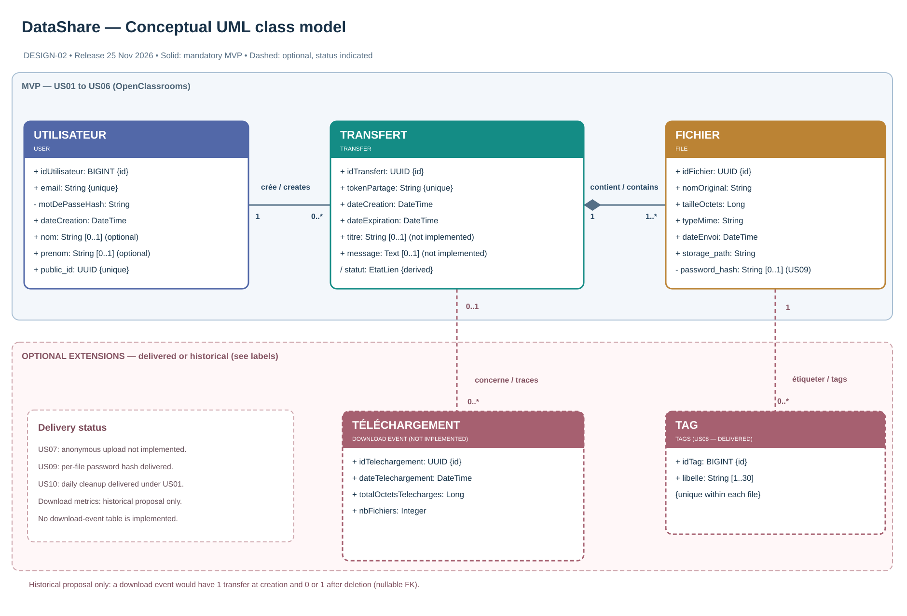

# DataShare — Modèle conceptuel de données (UML)

**Statut :** brouillon v0.2 — validation requise dans [DESIGN-02](https://github.com/jlbokass/datashare/issues/2). C'est une **conception métier**, pas une base de données déployée ni un modèle Laravel implémenté.

**Source :** OpenClassrooms, *DataShare – Spécifications fonctionnelles*, US01 à US06 obligatoires (pages 2 à 5). Le modèle de documentation technique fourni accepte explicitement une représentation **UML ou Merise** pour documenter le modèle de données.

- [English](data-model.md)
- [Diagramme UML éditable — draw.io](diagrams/data-model.drawio) (**deux pages :** MVP et extensions facultatives)
- [SVG du MCD MVP](diagrams/data-model.svg)

## 1. Diagramme de classes UML — MVP obligatoire

Un diagramme de classes UML peut servir de **modèle conceptuel** s'il décrit les entités métier, attributs et multiplicités plutôt que les tables SQL et méthodes techniques. Les identifiants sont annotés `{id}` : cela désigne leur rôle d'identifiant conceptuel, **pas encore une clé primaire SQL**.

### Entités et attributs proposés

| Entité | Attributs conceptuels | Exigence / choix de conception |
| --- | --- | --- |
| **UTILISATEUR** | `idUtilisateur: UUID {id}`; `email: String {unique}`; `motDePasseHash: String`; `dateCreation: DateTime` | Données de création de compte et connexion (US03, US04). Mot de passe haché et salé. |
| **UTILISATEUR — facultatif** | `nom: String [0..1]`; `prenom: String [0..1]` | Enrichissement possible du profil, **non demandé** dans US03. Aucun critère du MVP n'en dépend. |
| **TRANSFERT** | `idTransfert: UUID {id}`; `tokenPartage: String {unique}`; `dateCreation: DateTime`; `dateExpiration: DateTime` | Un token et une expiration pour un ensemble de fichiers : choix proposé, cohérent avec US01/US02. |
| **TRANSFERT — facultatif** | `titre: String [0..1]`; `message: Text [0..1]` | Utiles pour une interface enrichie, mais **pas obligatoires** dans les US officielles. |
| **TRANSFERT — calculé** | `/statut: EtatLien {derived}` | Déduit de la date d'expiration ; pas de statut nécessairement stocké en base. Un enregistrement purgé n'existe plus. |
| **FICHIER** | `idFichier: UUID {id}`; `nomOriginal: String`; `tailleOctets: Long`; `typeMime: String`; `dateEnvoi: DateTime` | Métadonnées nécessaires aux US01, US02, US05 et US06. |

### Associations et multiplicités UML

| Association | Multiplicité à la première extrémité | Multiplicité à la seconde extrémité | Interprétation |
| --- | --- | --- | --- |
| **UTILISATEUR — crée — TRANSFERT** | **1** près d'UTILISATEUR | **0..*** près de TRANSFERT | Chaque transfert a un utilisateur propriétaire ; un utilisateur peut n'avoir aucun transfert ou en créer plusieurs. |
| **TRANSFERT — contient — FICHIER** | **1** près de TRANSFERT | **1..*** près de FICHIER | Chaque fichier appartient à un transfert ; chaque transfert contient au moins un fichier. |

**Point UML important :** la multiplicité se place au voisinage de la **classe qu'elle dénombre**. `UTILISATEUR "1" — "0..*" TRANSFERT` n'impose donc pas un transfert minimum à chaque utilisateur.

Le **losange noir** côté TRANSFERT exprime une composition : supprimer un transfert supprime ses fichiers, mais supprimer un fichier individuel n'entraîne pas la suppression de ses voisins.

## 2. Règles métier et limites du MVP

| Règle | Conséquence |
| --- | --- |
| **US01 — téléversement** | L'utilisateur doit être connecté pour déposer un fichier ; l'objectif fonctionnel permet de transférer un ou plusieurs fichiers. Les octets sont stockés en privé, hors PostgreSQL. |
| **US01 — partage** | Un token unique non prédictible désigne le TRANSFERT proposé ; c'est un **choix de modélisation**, pas une structure imposée. |
| **US01 — expiration** | Durée par défaut : sept jours ; durée configurable, sept jours maximum. Les octets et métadonnées sont automatiquement supprimés à expiration. |
| **US02 — téléchargement** | Le destinataire disposant d'un lien valide consulte nom, type, taille et expiration avant téléchargement. Les liens inconnus/expirés donnent une erreur explicite. |
| **US03/04 — comptes** | Email unique, mot de passe haché et authentification JWT. |
| **US05 — historique** | Un utilisateur authentifié ne voit que ses fichiers, avec nom, taille, date d'envoi, expiration et état du lien. |
| **US06 — suppression** | Le propriétaire peut supprimer **un fichier individuel**. Ses octets et métadonnées disparaissent, les autres fichiers du transfert restent accessibles. Confirmation côté frontend. |
| **Invariant proposé** | Si le dernier fichier est supprimé, supprimer aussi le TRANSFERT devenu vide et invalider son token, pour respecter la cardinalité `1..*`. |
| **Statut calculé** | `/statut` dépend de `dateExpiration`; il n'est pas nécessaire de stocker une colonne. La purge éliminant les enregistrements expirés, l'affichage d'un historique expiré devra être concilié avec US05/US06. |

**Un lien pour plusieurs fichiers :** le regroupement permet un token et une expiration communs, tout en conservant la suppression individuelle. La décision doit être validée, car OC n'impose pas cette structure de données particulière.

## 3. Champs complémentaires : MCD et implémentation

- `cleStockage` sera nécessaire pour accéder au contenu depuis le stockage privé retenu, mais relève davantage du **modèle logique/physique** que du MCD minimal.
- `checksumSha256` peut servir à contrôler l'intégrité ; ce n'est **pas une exigence explicite** des US obligatoires.
- Placer `motDePasseHash` sur TRANSFERT protège tout un groupe de fichiers, alors qu'**US09 prévoit la protection d'un fichier**. Si US09 est développée, il faudra décider explicitement entre mot de passe par FICHIER et protection du transfert entier.
- `statut` devient une **propriété métier dérivée** (notation UML `/statut`), pas forcément une colonne persistée.

## 4. Extension facultative — traçabilité des téléchargements

La **deuxième page** du [fichier draw.io](diagrams/data-model.drawio) représente le concept proposé **TÉLÉCHARGEMENT**, **hors MVP obligatoire**.

Si chaque téléchargement concerne un fichier, un événement est rattaché à **un FICHIER**, et un fichier peut avoir **0..*** événements. C'est plus précis que de rattacher tous les événements au seul TRANSFERT lorsque plusieurs fichiers partagent un lien. Les attributs envisagés sont un identifiant, une date, une empreinte IP facultative et un user-agent facultatif.

Aucune US obligatoire ne réclame un historique persistant des téléchargements. Les empreintes IP et user-agents posent aussi des questions de minimisation, de conservation et de suppression des données personnelles. **Nous n'ajoutons donc pas de suivi ni de table d'événements au MVP sans justification.**

## 5. Points à confirmer avant validation

- [ ] Un lien peut-il contenir plusieurs fichiers avec une seule date d'expiration ?
- [ ] US06 supprime-t-elle bien un fichier sans affecter les autres ?
- [ ] Le transfert vide est-il supprimé après le dernier fichier ?
- [ ] Souhaitons-nous inclure les champs facultatifs nom/prénom et titre/message dans l'interface MVP ?
- [ ] La protection par mot de passe US09 et la traçabilité persistante restent hors MVP.
- [ ] Le modèle doit rester cohérent avec DESIGN-01 et DESIGN-03 et la documentation EN/FR doit rester synchronisée.

**Étape suivante :** après validation, en déduire le schéma PostgreSQL et les modèles Laravel. Clés primaires/étrangères, clés de stockage, index et migrations appartiennent au modèle technique ultérieur.
