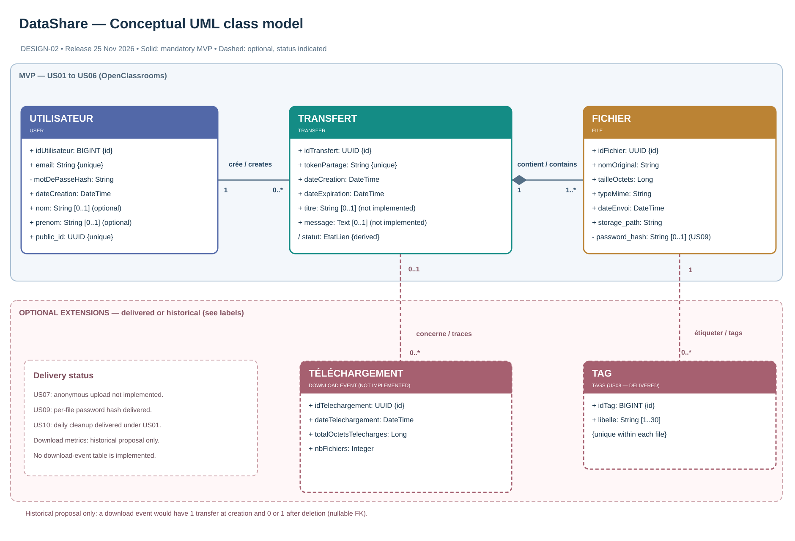

# DataShare — Conceptual data model (UML)

**Status:** Draft v0.2 — review required in [DESIGN-02](https://github.com/jlbokass/datashare/issues/2). This is **conceptual design**, not a deployed database or implemented Laravel model.

**Source:** OpenClassrooms *DataShare – Spécifications fonctionnelles*, mandatory US01–US06 (pp. 2–5). The supplied technical documentation template expressly accepts **UML or Merise** to document the conceptual model.

- [Français](data-model.fr.md)
- [Editable UML diagram — draw.io](diagrams/data-model.drawio) (**two tabs:** MVP and optional extensions)
- [SVG of the mandatory MVP model](diagrams/data-model.svg)

## 1. UML class diagram — mandatory MVP

A UML class diagram can represent a **conceptual data model** when it describes domain entities, attributes and multiplicities rather than technical SQL tables or implementation methods. Identifiers are domain identities (`{id}`), **not SQL primary-key declarations**.

### Entities and proposed attributes

| Entity | Conceptual attributes | Requirement / design interpretation |
| --- | --- | --- |
| **UTILISATEUR / USER** | `idUtilisateur: UUID {id}`; `email: String {unique}`; `motDePasseHash: String`; `dateCreation: DateTime` | Required account and login data (US03, US04). The password is securely hashed/salted. |
| **UTILISATEUR — optional** | `nom: String [0..1]`; `prenom: String [0..1]` | Suggested enrichment of a user profile, **not required** for US03. No MVP acceptance criterion depends on these fields. |
| **TRANSFERT / TRANSFER** | `idTransfert: UUID {id}`; `tokenPartage: String {unique}`; `dateCreation: DateTime`; `dateExpiration: DateTime` | One proposed share token and expiry date for a group of files (US01, US02). |
| **TRANSFERT — optional** | `titre: String [0..1]`; `message: Text [0..1]` | Useful for a richer sharing UI, **not mandatory** in the official user-story text. |
| **TRANSFERT — derived** | `/statut: EtatLien {derived}` | Calculated from expiry; not a persisted status. A purged record no longer appears. |
| **FICHIER / FILE** | `idFichier: UUID {id}`; `nomOriginal: String`; `tailleOctets: Long`; `typeMime: String`; `dateEnvoi: DateTime` | File metadata needed for upload, download, history and individual deletion (US01, US02, US05, US06). |

### UML associations and multiplicities

| Association | At UTILISATEUR / TRANSFERT end | At TRANSFERT / FICHIER end | Meaning |
| --- | --- | --- | --- |
| **UTILISATEUR — creates — TRANSFERT** | **1** (USER end) | **0..*** (TRANSFER end) | Each transfer has one registered owner; each user may create zero or many transfers. |
| **TRANSFERT — contains — FICHIER** | **1** (TRANSFER end) | **1..*** (FILE end) | Each file belongs to exactly one transfer; each transfer contains one or more files. |

**Important:** In UML, a multiplicity is written near the class it counts, at the **end of the association**. Therefore `UTILISATEUR "1" — "0..*" TRANSFERT` is the intended reading, **not** a minimum of one transfer per registered user.

A **filled diamond** on the TRANSFERT end of the second association indicates a composition/lifecycle relationship: deleting a transfer deletes its files, although an individual file may be deleted without deleting sibling files.

## 2. Business rules and MVP boundary

| Rule | Consequence |
| --- | --- |
| **US01 — upload** | An authenticated user can upload a file; the platform permits one or more files to be transferred. File content is stored privately, outside PostgreSQL. |
| **US01 — sharing** | A unique, unpredictable token identifies the proposed TRANSFERT; this is a **design decision**, not an imposed entity structure. |
| **US01 — expiry** | Expiration defaults to seven days and is user configurable up to seven days. Uploaded bytes and associated metadata must be automatically deleted on expiry. |
| **US02 — download** | A recipient holding a valid share link can inspect filename, type, size and expiry date before downloading. An expired/invalid link produces a clear error. |
| **US03/04 — users** | Email is unique; password hashing is mandatory, and authentication is based on JWT. |
| **US05 — history** | A logged-in owner sees only their uploaded files, including filename, size, upload date, expiry and valid/expired link status. |
| **US06 — deletion** | The owner can delete an **individual file**. Its bytes and metadata are deleted, and siblings in the same transfer remain available. Confirmation is required in the frontend. |
| **Model invariant** | **Proposal:** deleting the final file also deletes the now-empty TRANSFERT and invalidates the share token, preserving the `1..*` cardinality. |
| **Derived status** | `/statut` derives from `dateExpiration`; no stored status is required. Because expiry purge removes records, a historical expired item might disappear; this behavior must be reconciled with US05/US06 presentation rules. |

**One transfer / multiple files:** This design groups files under one share token and one expiry date, but it still permits each file to be managed independently. The grouping requires confirmation: the OC specifications do not prescribe a particular relational model.

## 3. Your additional fields: conceptual vs implementation

- `cleStockage` (**storage key**) will be necessary when mapping file content to the chosen private storage, but it belongs in the **logical/physical model** rather than the minimal conceptual MCD.
- `checksumSha256` is a potentially valuable integrity control; it is **not explicitly mandated** by the core stories and should only be implemented if justified.
- `motDePasseHash` on TRANSFERT would imply **batch-level** protection, whereas optional **US09 describes password protection for a file**. If US09 is later prioritized, decide whether the password is per FILE or applies to the whole transfer; do not silently treat these as equivalent.
- `statut` is a **derived domain property** (`/statut` in UML), not necessarily a database column.

## 4. Optional extension — download logging

The **second page** of the [draw.io diagram](diagrams/data-model.drawio) illustrates the suggested **TÉLÉCHARGEMENT / DOWNLOAD EVENT** concept, separately from the mandatory MVP.

A per-file download event is associated with **one FICHIER**, and a file may have **0..*** events. This is more informative than associating all events only with TRANSFERT when one share can include multiple files. Candidate attributes are event identifier, timestamp, optional IP hash and optional user agent.

No mandatory user story requires persistent download auditing. IP hashes and user agents also introduce privacy, minimization, deletion and retention obligations. **No event table or tracking should be added to the MVP without a documented reason.**

## 5. Pending design review

- [ ] Confirm that one share link may represent multiple files, with a single expiry date.
- [ ] Confirm that US06 removes one file while keeping sibling files available.
- [ ] Confirm removal of an empty transfer after its last file is deleted.
- [ ] Decide whether optional name/first name and title/message fields are worthwhile for the MVP UI; they are not required by the official US.
- [ ] Keep password protection (US09) and persistent download tracing outside the MVP.
- [ ] Check consistency with DESIGN-01 architecture and upcoming DESIGN-03 OpenAPI; maintain FR/EN parity.

**Next step:** only after review, derive the PostgreSQL schema and Laravel models. Primary keys, foreign keys, storage keys, indexes and migration details belong to that subsequent technical model.
