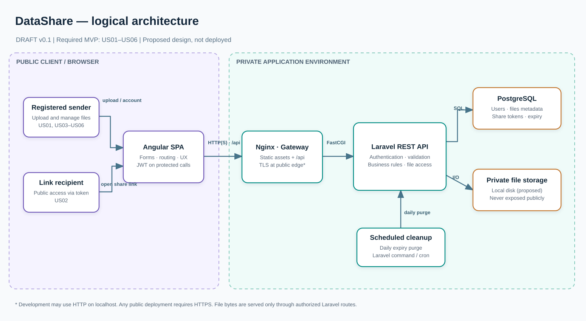

# DataShare — Documentation technique (OC P3)

[**English**](technical-documentation.md) · [Accueil de la documentation](index.fr.md)

**État au 18 novembre 2026 : document évolutif, non encore livrable final de soutenance.** Organisation en **huit sections** selon le *Modèle de documentation technique* fourni par OC. Les preuves encore absentes sont signalées sans inventer de résultat. Les sujets et modèles d'origine restent en français ; nos documents sont produits en FR/EN.

## 1. Architecture de l'application (schéma simple)

[Explications](architecture.fr.md) · [Diagramme draw.io modifiable](diagrams/architecture.drawio).

- Navigateur Angular 22 (TypeScript/SCSS) → passerelle **Nginx** locale `127.0.0.1:8080` → API REST Laravel 13 (PHP 8.4-FPM) → PostgreSQL 18 et **stockage local privé**.
- Frontend et API partagent la même origine en développement. L'accès HTTP local ne signifie **pas qu'HTTPS est déployé en production**.
- Docker Compose orchestre backend, frontend, Nginx, BDD et scheduler. La purge US01 retire automatiquement les fichiers expirés et leurs métadonnées. Téléchargement public : US02 à venir.
- Versionnage sur GitHub : `main` protégée, `develop` d'intégration, PR par lot. GitHub Pages publie **uniquement la documentation statique**.

## 2. Choix technologiques justifiés (livrable 1–2 pages)

[Justification complète des technologies](technology-choices.fr.md) et comparaison des alternatives autorisées :

| Domaine | Technologie retenue | Justification / alternative |
| --- | --- | --- |
| Backend | PHP 8.4, Laravel 13 | Expérience PHP du développeur, validation, Eloquent, stockage et scheduler ; Symfony était autorisé |
| Frontend | Angular 22 / TypeScript | SPA structurée, typage, formulaires et routing ; Vue ou React possibles |
| BDD | PostgreSQL 18 | Relations et contraintes entre utilisateurs, transferts et fichiers ; MongoDB possible |
| Stockage | Disque privé Laravel | MVP plus simple, choix autorisé ; S3 envisageable plus tard |
| Authentification | JWT HS256 via `firebase/php-jwt` v7.2.2 | Front/back séparés, validation systématique côté API |
| HTTP/local | Nginx + PHP-FPM + Docker Compose | Environnement reproductible et point d'entrée unique |
| Outils | GitHub, Composer, npm, PHPUnit, tests Angular | Traçabilité et reproductibilité ; CI encore à implémenter |

La justification retrace les **choix initiaux**, tandis que les versions ci-dessus correspondent aux dépendances et fichiers effectivement intégrés.

## 3. Modèle de données

[MCD UML conceptuel](data-model.fr.md) · [Diagramme SVG](diagrams/data-model.svg) · [draw.io](diagrams/data-model.drawio).

- **UTILISATEUR** : clé Laravel numérique interne, email unique, hash salé, UUID public et date de création. Nom facultatif ; aucun rôle administrateur MVP.
- **TRANSFERT** (US01) : UUID, propriétaire, token de partage imprévisible unique, dates de création et d'expiration. Un utilisateur peut posséder plusieurs transferts.
- **FICHIER** (US01) : UUID, transfert parent, nom d'origine, taille, type MIME, chemin privé et dates. Un transfert contient **un ou plusieurs fichiers**.
- Les migrations physiques sont versionnées dans `backend/database/migrations/`. Les tags et statistiques facultatives du dessin DESIGN-02 **ne sont pas implémentés**. Une éventuelle conservation statistique nécessitera une analyse RGPD distincte.

## 4. Contrat d'API REST

[Guide API](api/README.fr.md) · [Spécification OpenAPI 3.1](api/openapi.yaml).

| Route du contrat | État |
| --- | --- |
| `POST /api/auth/register` | **US03**, réalisée, 201/422 |
| `POST /api/auth/login` | **US04**, réalisée, JWT signé |
| `GET /api/auth/me` | **US04**, protégée JWT |
| `POST /api/transfers` | **US01**, upload multipart authentifié, 201 et lien |
| `GET /api/shares/{token}`, `GET /api/shares/{token}/files/{fileId}` | **US02 en attente** ; lien actuel vers une page temporaire |
| `GET /api/transfers` | **US05 en attente** |
| `DELETE /api/transfers/{transferId}/files/{fileId}` | **US06 en attente** |

`GET /api/health` est uniquement une route de diagnostic technique, pas une US OC. Le contrat décrit des statuts 401/404/410/413/422 ; ne pas annoncer les routes non codées comme disponibles.

## 5. Sécurité et gestion des accès

[Mesures, risques et futurs scans](https://github.com/jlbokass/datashare/blob/develop/SECURITY.fr.md).

- Mots de passe hashés et salés, email unique. JWT HS256 signé avec clé `JWT_SECRET` dédiée, expiration ~30 min, vérification Laravel. Le JWT Angular reste en mémoire ; une actualisation impose une nouvelle connexion. La déconnexion côté navigateur **ne révoque pas** le jeton émis.
- Upload réservé aux utilisateurs authentifiés ; stockage privé hors répertoire web, noms générés. Contrôle MIME + extension, **1 000 000 000 octets par fichier** et limites d'exploitation choisies de 5 fichiers / 2 Go cumulés. Expiration 7 jours par défaut, réglable de 1 à 7 jours.
- Démo de cinq minutes : **flag local uniquement**, jamais une durée OC standard ; refus hors local/test ou flag absent.
- ZIP stocké comme octets opaques, **sans antivirus** ; dossier direct non géré. Protection par mot de passe **US09 facultative non réalisée**. [Arbitrage US02 #5](https://github.com/jlbokass/datashare/issues/5).
- **HTTPS en production, audit, scan, durcissement et sauvegardes sécurisées ne sont pas encore démontrés.**

## 6. Qualité, tests et maintenance

Les quatre fichiers prévus par OC sont à la racine du dépôt, chacun avec un équivalent anglais :

| Fichier OC | Contenu | Preuve disponible |
| --- | --- | --- |
| [TESTING.md](https://github.com/jlbokass/datashare/blob/develop/TESTING.fr.md) · [EN](https://github.com/jlbokass/datashare/blob/develop/TESTING.md) | Plan, critères, commandes, E2E futurs, objectif indicatif de couverture 70 % | Tests locaux **déclarés verts par le développeur**, couverture **non mesurée** |
| [SECURITY.md](https://github.com/jlbokass/datashare/blob/develop/SECURITY.fr.md) · [EN](https://github.com/jlbokass/datashare/blob/develop/SECURITY.md) | Accès, restrictions, risques et scan futur | **Aucune preuve de scan** |
| [PERF.md](https://github.com/jlbokass/datashare/blob/develop/PERF.fr.md) · [EN](https://github.com/jlbokass/datashare/blob/develop/PERF.md) | Plan k6 sur route critique, budget bundle, métriques à relever | **Aucune mesure réelle** |
| [MAINTENANCE.md](https://github.com/jlbokass/datashare/blob/develop/MAINTENANCE.fr.md) · [EN](https://github.com/jlbokass/datashare/blob/develop/MAINTENANCE.md) | Docker, BDD, purge, mises à jour, périodicité, risques | Procédure locale, **aucun test de reprise production** |

**Recette US01 :** migrations, tests backend/frontend, build, PDF/multifichier, correction retour accueil et démo cinq minutes déclarés verts par le développeur. **La conformité Figma reste à corriger** dans [UI-01 #37](https://github.com/jlbokass/datashare/issues/37). Les sorties détaillées du terminal ne sont pas archivées ici.

## 7. Installation et exécution

[Guide Docker-first](docker-setup.fr.md) · [Environnement local complet](development.fr.md) · [Recette US01](us01-upload.fr.md).

1. Docker Desktop/Compose et Git ; fichiers privés `.env` à la racine (PostgreSQL) et `backend/.env` (clé Laravel `APP_KEY`, clé JWT indépendante), **jamais versionnés**.
2. Depuis la racine, exécuter `docker compose config --quiet` puis `docker compose up -d --build`.
3. Appliquer `docker compose exec -T app php artisan migrate --force`, vérifier `docker compose ps` et `docker compose exec -T app php artisan schedule:list`. **Ne pas lancer `migrate:fresh`** sur une base utile.
4. Accès Angular : **http://127.0.0.1:8080/** ; connexion sur `/login`. Fichiers privés : `backend/storage/app/private/transfers`. Téléchargement public non disponible avant US02.
5. Tests : commandes dans TESTING.md. `docker compose down` conserve les volumes ; `down -v` détruirait les données.

L'hébergement de production, HTTPS, scripts de déploiement et procédures de restauration **ne sont pas encore livrés**.

## 8. Utilisation de l'IA dans le développement

[Journal IA FR](ai-journal.fr.md) · [English](ai-journal.md).

Le développeur décide du périmètre, supervise le travail, relit et valide les résultats ; l'IA participe à des tâches délimitées de conception, code, tests, documentation et gestion GitHub. Exemples : corrections UML/OpenAPI, socle Docker, US03/US04 et upload/purge US01, corrections issues de la recette. L'historique Git/PR documente ces activités ; aucun prompt ou test n'est inventé.

**Point de conformité à confirmer :** la mission OC fournie contient une ancienne restriction (« IA sur une seule US »). Le développeur indique que son mentor la considère obsolète. **La consigne écrite actualisée n'a pas été vérifiée** ; s'assurer de la règle applicable avant la remise finale.

## Travail restant pour la remise finale

Terminer US02/US05/US06, automatiser 2–3 scénarios E2E, fournir le rapport de couverture (objectif indicatif 70 %), exécuter un scan de sécurité et un test de performance sur un endpoint critique avec chiffres réels, arbitrer ZIP/US02, corriger les écarts Figma UI-01, documenter production/HTTPS et finaliser la maintenance. Ce document est **l'index technique évolutif**, pas un substitut aux preuves absentes.
