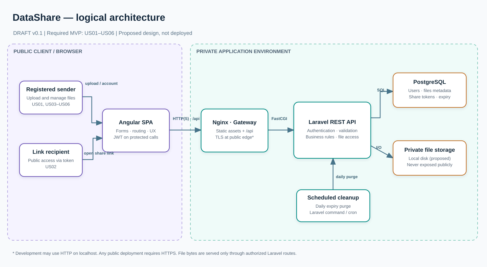

# DataShare — Technical documentation

[**Français**](technical-documentation.fr.md) · [Documentation home](index.md) · [GitHub repository](https://github.com/jlbokass/datashare)

**Status as of 22 November 2026.** Mandatory MVP **US01–US06** is implemented on `develop`. E2E tests and all three CI workflows passed on [PR #52](https://github.com/jlbokass/datashare/pull/52), **still a draft and not merged**. No production deployment is claimed.

## 1. Application architecture



[Description](architecture.md) · [Editable draw.io](diagrams/architecture.drawio)

**Angular browser → Nginx → Laravel API → PostgreSQL and private file storage.** Nginx provides a single HTTP origin in development; Docker Compose runs the application, database and expiry scheduler. Public download links are separate from the JWT required for owner actions. Local HTTP is not evidence of production HTTPS.

## 2. Technology choices and rationale

[Detailed 1–2-page comparison and rationale](technology-choices.md)

| Area | Choice | Main reason |
| --- | --- | --- |
| Frontend | Angular 22, TypeScript | Structured components/forms and static typing |
| Backend | PHP 8.4, Laravel 13 | Integrated API, validation, storage and scheduler |
| Database | PostgreSQL 18 | Relations between users, transfers and files |
| File storage | Private local filesystem | Simple MVP solution allowed by the specifications |
| Authentication | JWT HS256 | Stateless API with server-side access checks |
| Tooling | Docker Compose, Nginx, GitHub Actions | Repeatable development and automated PR verification |

## 3. Data model

[UML conceptual model](data-model.md) · [Diagram](diagrams/data-model.svg)

Three main entities: **User** (unique email, password hash), **Transfer** (owner, public token, expiry) and **File** (name, type, size and private storage locator). A user owns many transfers; each transfer contains one or more files. PostgreSQL migrations are versioned in `backend/database/migrations/`. Optional US08 tags are not implemented.

## 4. REST API documentation

[OpenAPI 3.1 contract](api/openapi.yaml) · [Endpoint guide](api/README.md)

| Feature | Main endpoints |
| --- | --- |
| US03 / US04 — registration and authentication | `POST /api/auth/register`, `POST /api/auth/login`, `GET /api/auth/me` |
| US01 — authenticated upload | `POST /api/transfers` |
| US02 — public sharing/download | `GET /api/shares/{token}`, `GET /api/shares/{token}/files/{fileId}` |
| US05 — owner history | `GET /api/transfers` |
| US06 — individual file deletion | `DELETE /api/transfers/{transferId}/files/{fileId}` |

These routes are implemented; request/response schemas and statuses are documented in OpenAPI. Private owner actions require a JWT, whereas a valid public share is accessible anonymously.

## 5. Security and access management

- **Accounts:** salted password hashes and unique emails. Signed JWTs are verified by Laravel and held only in Angular memory; logout clears local session state but **does not revoke** an issued JWT (about 30-minute lifetime).
- **Files:** storage outside the public web root under opaque internal names; MIME and extension checks; 1 GB per-file limit (5 files and 2 GB per transfer are chosen MVP caps). Downloads are forced as attachments.
- **Shares:** unpredictable token, 1–7-day expiry, invalid/expired-link rejection and scheduled cleanup of bytes and metadata. ZIP archives are **not antivirus-scanned**.
- **Limits:** public HTTPS hosting, tested backup/restore and a complete security audit have not been demonstrated. A **basic dependency vulnerability scan remains outstanding** in [SECURITY](https://github.com/jlbokass/datashare/blob/develop/SECURITY.md).

## 6. Quality, tests and maintenance

| Required document | Status and reference |
| --- | --- |
| **TESTING.md** | [Plan, criteria and evidence](https://github.com/jlbokass/datashare/blob/quality/ql-02-clean/TESTING.md): **52 Laravel**, **44 Angular** and **6 Playwright** tests passing; **96.36%** backend and **79.58%** frontend line coverage; three CI workflows passing on [PR #52](https://github.com/jlbokass/datashare/pull/52) |
| **SECURITY.md** | [Controls and risks](https://github.com/jlbokass/datashare/blob/develop/SECURITY.md) documented; **vulnerability scan not yet executed** |
| **PERF.md** | [Performance plan](https://github.com/jlbokass/datashare/blob/develop/PERF.md) available; **measured critical endpoint and frontend budget still missing** |
| **MAINTENANCE.md** | [Local operations](https://github.com/jlbokass/datashare/blob/develop/MAINTENANCE.md), dependency update cadence and risks documented; no production recovery test |

Line coverage exceeds the indicative 70% target. A durable coverage report screenshot is still needed for the assessment. Test details remain in **TESTING** rather than being repeated here.

## 7. Installation and execution

[Full README](https://github.com/jlbokass/datashare/blob/develop/README.md) · [Docker guide](docker-setup.md)

**Prerequisites:** Git, Docker and Compose. Initialize private `.env` files as documented in the README, including PostgreSQL, Laravel and JWT secrets; never commit them.

From repository root after initializing dependencies:

```bash
docker compose up -d --build
docker compose exec -T app php artisan migrate --force
bash scripts/qa.sh all
```

The application is served at `http://127.0.0.1:8080/`. E2E tests use **`compose.test.yaml`**, isolated from development data (see TESTING). Do not use `docker compose down -v` on valuable databases. Production deployment has not been performed.

## 8. AI use in development

[AI development journal](ai-journal.md) · [French journal](ai-journal.fr.md)

AI assisted with scoped implementations, tests and documentation; the developer defined tasks, ran acceptance checks, requested corrections and approved changes. The journal distinguishes AI work from human verification and links relevant issues/PRs.

**To clarify before the assessment:** the written mission limits AI-developed work to one User Story, while the journal records contributions spanning multiple stories. Confirm the applicable guidance and accurately present those contributions without altering the history.

## Outstanding assessment work

**Required items still open:** basic security scan, measured critical-endpoint benchmark and frontend performance budget, durable coverage screenshot, and [Figma / responsive / accessibility review](https://github.com/jlbokass/datashare/issues/37). The presentation deck and self-assessment must also be prepared. None of these require additional E2E scenarios.
